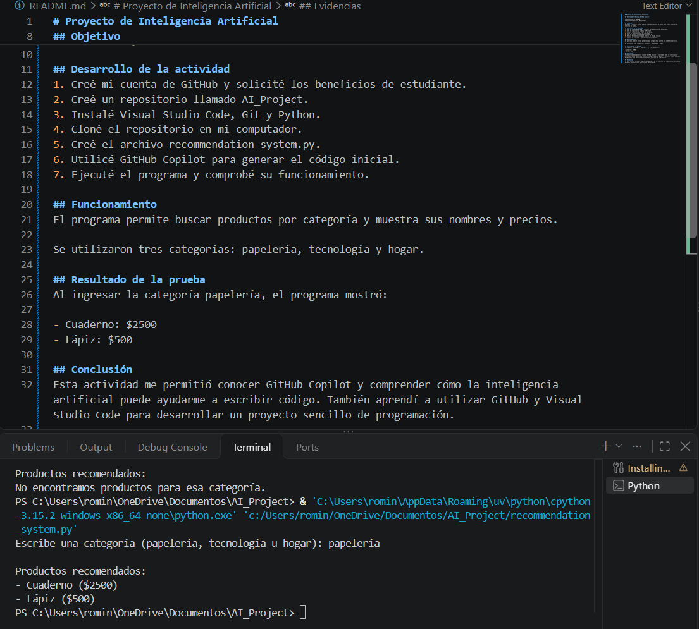
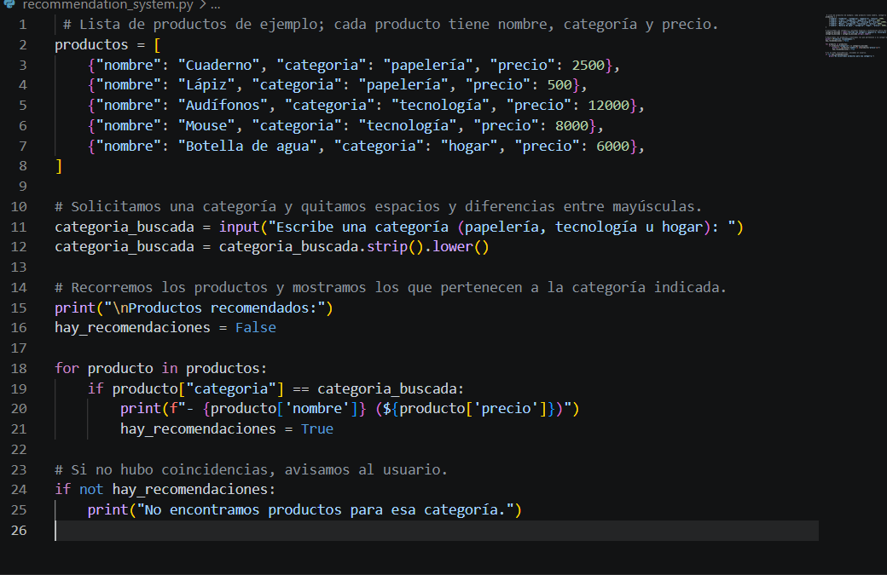

# Proyecto de Inteligencia Artificial

## Actividad formativa: GitHub Copilot

**Institución:** INACAP
**Carrera:** Analista Programador

## Objetivo
Aprender a utilizar GitHub Copilot como herramienta de apoyo para crear un programa sencillo en Python.

## Desarrollo de la actividad
1. Creé mi cuenta de GitHub y solicité los beneficios de estudiante.
2. Creé un repositorio llamado AI_Project.
3. Instalé Visual Studio Code, Git y Python.
4. Cloné el repositorio en mi computador.
5. Creé el archivo recommendation_system.py.
6. Utilicé GitHub Copilot para generar el código inicial.
7. Ejecuté el programa y comprobé su funcionamiento.

## Funcionamiento
El programa permite buscar productos por categoría y muestra sus nombres y precios.

Se utilizaron tres categorías: papelería, tecnología y hogar.

## Resultado de la prueba
Al ingresar la categoría papelería, el programa mostró:

- Cuaderno: $2500
- Lápiz: $500

## Conclusión
Esta actividad me permitió conocer GitHub Copilot y comprender cómo la inteligencia artificial puede ayudarme a escribir código. También aprendí a utilizar GitHub y Visual Studio Code para desarrollar un proyecto sencillo de programación.

## Evidencias
En esta sección agregaré capturas de pantalla de la creación del repositorio, el código generado con Copilot y la ejecución del programa.
### Resultado del programa

### Código generado con GitHub Copilot

